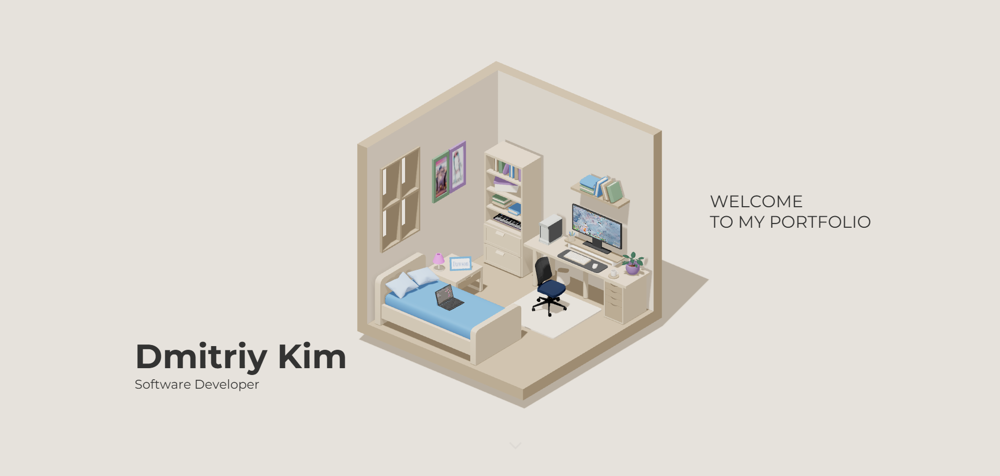

# Room Portfolio

## Project Overview

This portfolio website is inspired by the work of Boko33. I started by 3D modeling my room in Blender, focusing on capturing its details. The assets were then imported into the Three.js library, and I used HTML, CSS, and JavaScript to build the website. I added animations using GSAP to make the experience more dynamic and interactive. This project highlights my skills in combining design and coding to create an engaging portfolio.

## Demo



[Go to Web Demo (Cloudflare Server)](https://dmitriykim.ca)

[Go to Web Demo (Render Server)](https://room-portfolio-0tlu.onrender.com)


## Features

- [x] 3D model of my room in Blender
- [x] Assets imported into Three.js
- [x] Scene, lighting and orthographic camera setup
- [x] About me, my work and contact sections
- [x] Smooth scrolling
- [x] Intro animation and loader
- [x] Custom progress bar
- [x] Dialog boxes for each project
- [x] Mobile styling

## Used Libraries and Frameworks

[**Three.js**](https://threejs.org/): a cross-browser JavaScript library and API used to create and display animated 3D computer graphics in a web browser using WebGL.

[**Blender**](https://www.blender.org/): a free and open-source 3D computer graphics tool set used to model the room.

[**GSAP**](https://gsap.com/): a JavaScript animation library used for the intro and scroll-driven animations (with ScrollTrigger).

[**Lenis**](https://lenis.darkroom.engineering/): a lightweight smooth-scrolling library.

## Running Locally

```bash
npm install
npm run dev
```

Build for production with `npm run build` and preview the build with `npm run preview`.

## Screenshots

### Welcome View


### About Me View


### My Work


### Contact

